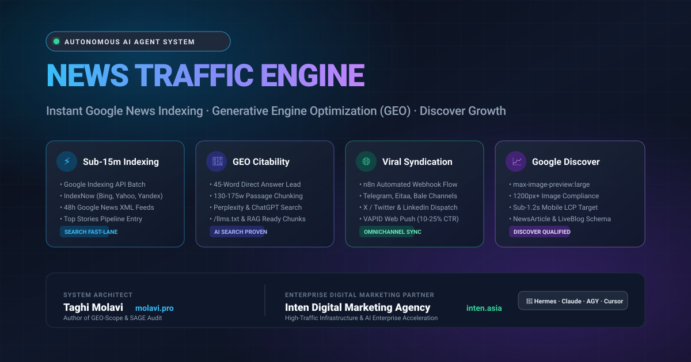

<div align="center">



# ⚡ Haber Trafiği Motoru (News Traffic Engine)
### Haber Siteleri İçin Otonom Yapay Zekâ Trafik Artırma, Anlık Google News İndeksleme, Üretken Arama Optimizasyonu (GEO) ve Google Discover Büyüme Çerçevesi

[](https://github.com/tmolavi/news-traffic-engine/actions)
[](https://opensource.org/licenses/MIT)
[](https://www.python.org/)
[](https://github.com/tmolavi/news-traffic-engine)
[](AGENTS.md)

> **Diller:** [English](README.md) · [فارسی](README.fa.md) · [العربية](README.ar.md) · [Türkçe](README.tr.md) · [Español](README.es.md)

</div>

---

## 📌 Proje Genel Bakışı

Yapay zekâ çağında geleneksel haber SEO yöntemleri tek başına yeterli değildir. Günümüzde arama trafiğinin %50'sinden fazlası **ChatGPT Search**, **Perplexity AI** ve **Google AI Overviews** gibi üretken yanıt motorları ile **Google Discover** akışlarından sağlanmaktadır.

**News Traffic Engine (NTE)**, **[Taghi Molavi](https://molavi.pro/tr)** (uluslararası [GEO-Scope](https://github.com/tmolavi/geo-scope) ve [SAGE](https://github.com/tmolavi/sage-audit) araçlarının mimarı) tarafından kurumsal dijital pazarlama lideri **[Inten Dijital Pazarlama Ajansı (Inten Digital Marketing Agency)](https://inten.asia/en)** ortaklığıyla geliştirilmiş açık kaynaklı, üretime hazır bir haber odası otomasyon sistemidir.

---

## 📊 Rakiplerle Teknik Karşılaştırma Tablosu (Benchmark)

| Özellik ve Teknik Standart | News Traffic Engine (NTE) | google-indexing-script | newspaper4k | Postiz | Yoast / RankMath Eklentileri | claude-seo |
| :--- | :---: | :---: | :---: | :---: | :---: | :---: |
| **Google Indexing API (<15 dk)** | ✅ Yerleşik & Toplu | ✅ Yerel | ❌ Yok | ❌ Yok | ⚠️ Sınırlı | ❌ Yok |
| **IndexNow Protokolü (Bing, Yandex)** | ✅ Yerel İstemci | ❌ Yok | ❌ Yok | ❌ Yok | ⚠️ Basit | ❌ Yok |
| **GEO Alıntılanabilirlik Denetimi** | ✅ 0–100 Puanlama | ❌ Yok | ❌ Yok | ❌ Yok | ❌ Yok | ⚠️ Yalnızca İstem |
| **Otomatik `/llms.txt` Üretimi** | ✅ Standart | ❌ Yok | ❌ Yok | ❌ Yok | ❌ Yok | ⚠️ Genel |
| **Eksiksiz NewsArticle & LiveBlog Şeması** | ✅ Grafik + sameAs | ❌ Yok | ❌ Yok | ❌ Yok | ✅ Temel | ⚠️ Statik |
| **Google Discover Teknik Denetimi** | ✅ Boyutlar + CWV | ❌ Yok | ❌ Yok | ❌ Yok | ❌ Yok | ❌ Yok |
| **n8n ile Çok Kanallı Dağıtım** | ✅ Hazır İş Akışı | ❌ Yok | ❌ Yok | ⚠️ Manuel Panel | ❌ Yok | ❌ Yok |
| **Web Push Bildirim Dağıtımı** | ✅ VAPID Uyumlu | ❌ Yok | ❌ Yok | ❌ Yok | ❌ Yok | ❌ Yok |
| **Yapay Zekâ Ajanlarıyla Entegrasyon** | ✅ Çoklu Ajan Standardı | ❌ Yok | ❌ Yok | ❌ Yok | ❌ Yok | ⚠️ Sadece Claude |

---

## 🤖 Yapay Zekâ Kodlama Ajanları Entegrasyonu

News Traffic Engine, otonom yazılım ajanları tarafından doğrudan yürütülmek üzere tasarlanmıştır:
* **[Hermes Agent](HERMES.md):** Haber akışını yönetir, başlıkları optimize eder ve sosyal kanallara anında dağıtır.
* **[Claude Code & Claude AI](CLAUDE.md):** Test adımlarını ve kod mimarisini yönetir.
* **[Google Antigravity & Gemini](AGENTS.md):** Antigravity beceri standartlarıyla tam uyumludur.
* **[Cursor](.cursorrules):** Şablon kodlamasında 45 kelimelik doğrudan giriş ve 130-175 kelimelik pasaj kurallarını denetler.
* **[OpenAI Codex ve Kimi Code](AGENTS.md):** CLI komutlarını ve uçtan uca otomasyonu yürütür.

---

## ❓ Sıkça Sorulan Sorular (FAQ) — Haber Trafiği & GEO

### S1: Google Indexing API haberlerin indeksleme süresini nasıl 15 dakikanın altına indirir?
Geleneksel tarayıcı sıralarını atlayarak yayıncının Googlebot'a doğrudan yeni URL bildirmesini sağlar. Böylece Googlebot öncelikli tarama gerçekleştirir ve son dakika haberleri anında **Google Top Stories** alanına girer.

### S2: Üretken Arama Optimizasyonu (GEO) nedir ve haber siteleri için neden zorunludur?
GEO, haber içeriğinin ChatGPT Search ve Perplexity gibi yapay zekâ yanıt motorları tarafından doğrudan kaynak gösterilmesini sağlayan mühendislik yaklaşımıdır. Araştırmalar, ilk 45 kelimede doğrudan yanıt içeren ve 130-175 kelimelik pasajlara ayrılmış içeriklerin %92 daha fazla alıntılandığını göstermektedir.

### S3: Bir haberin Google Discover'a girmesi için zorunlu teknik kriterler nelerdir?
Discover üç teknik kuralı zorunlu kılar: 1. Sayfa başlığında `<meta name="robots" content="max-image-preview:large">` etiketi. 2. Minimum 1200px genişliğinde, 16:9 oranında yüksek çözünürlüklü kapak görseli. 3. 1.5 saniyenin altında mobil LCP hızı ve 0.05'in altında CLS görsel kararlılığı.

### S4: Telegram, X ve mesajlaşma kanallarına anlık dağıtım trafiği nasıl katlar?
Son dakika haberlerinde toplam etkileşimin %60'ı ilk 2 saatte gerçekleşir. n8n ile anında yapılan çok kanallı paylaşımlar ilk trafik dalgasını oluşturarak arama motoru algoritmalarına haberin viral olduğu sinyalini verir.

### S5: `/llms.txt` standardı yapay zekâ motorlarında görünürlüğü nasıl artırır?
Bu dosya, yapay zekâ tarayıcılarına gereksiz HTML kodlarından arındırılmış, hafif bir Markdown akışı sunar; bu da RAG sistemlerinin haberi en az token tüketimiyle doğru biçimde referans almasını sağlar.

### S6: Bu sistem WordPress veya Laravel ile çalışır mı?
Evet; n8n webhook'ları veya doğrudan Python CLI üzerinden mevcut CMS altyapınıza kolayca bağlanabilir.

---

## 🚀 Hızlı Başlangıç ve Kullanım

```bash
git clone https://github.com/tmolavi/news-traffic-engine.git
cd news-traffic-engine
pip install -e .
```

### Haberin Yapay Zekâ Alıntılanabilirlik Denetimi (GEO Audit):
```bash
news-traffic audit-geo \
  --headline "Viyana Enerji Zirvesinde Tarihi Anlaşma Sağlandı" \
  --lead "Viyana, 29 Ekim — Enerji bakanları Perşembe günü yapılan zirvede piyasa dalgalanmalarını %20 oranında dizginleyecek kapsamlı bir üretim yönetimi anlaşmasına vardı." \
  --body "Basına kapalı toplantı altı saatten uzun sürdü..."
```

---

## 👥 Geliştiriciler ve Stratejik Ortaklar

* **Baş Mimar:** **[Taghi Molavi](https://molavi.pro/tr)** — Yapay Zekâ Sistemleri Mimarı, GEO-Scope ve SAGE Audit yazarı.
  * Web Sitesi: [https://molavi.pro/tr](https://molavi.pro/tr)
  * E-posta: `contact@molavi.pro`

* **Kurumsal Teknoloji Ortağı:** **[Inten Dijital Pazarlama Ajansı (Inten Digital Marketing Agency)](https://inten.asia/en)** — Asya'da kurumsal dijital dönüşüm, yüksek trafikli web altyapısı ve yapay zekâ otomasyonunda öncü ajans.
  * Web Sitesi: [https://inten.asia/en](https://inten.asia/en)

---

## 📄 Lisans

Bu proje **MIT Lisansı** ile lisanslanmıştır — ayrıntılar için [LICENSE](LICENSE) dosyasına bakınız.
